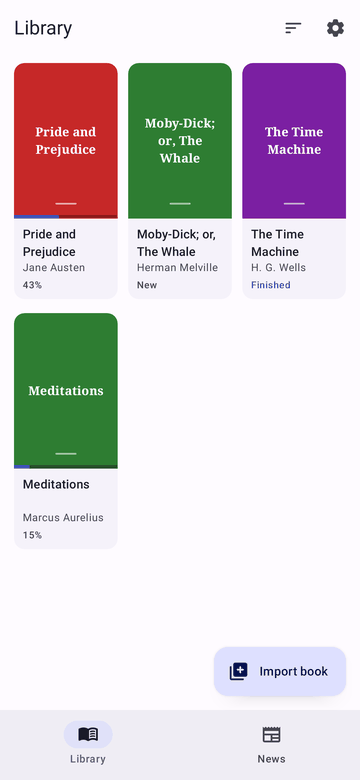
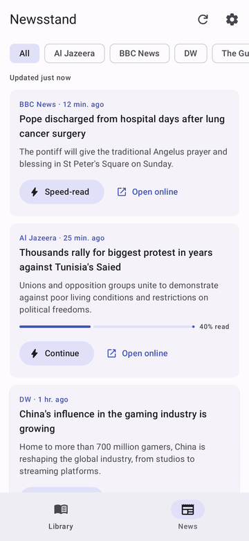
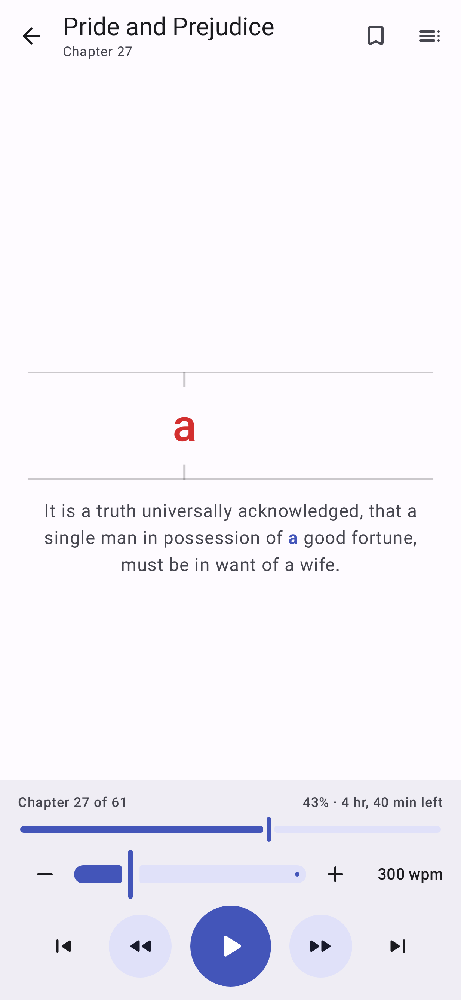
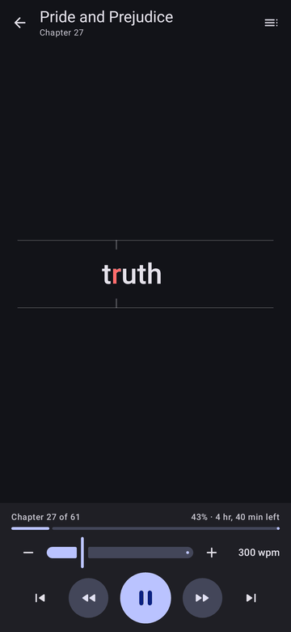
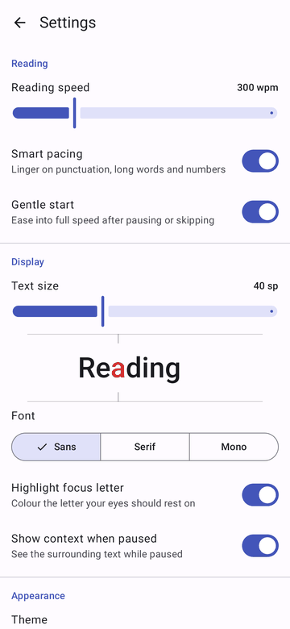

# SpeedRead

An Android EPUB, PDF and news reader built on **Rapid Serial Visual Presentation (RSVP)**: words flash one
at a time at a fixed point, each aligned on its optimal recognition point (the red letter),
so your eyes stay still while you read.

<p>
  
  
  
  
  
</p>

## Features

- **EPUB and PDF import.** Standard EPUB 2/3 files and text-based PDFs from the system file
  picker (several at once), "Open with", or "Share". PDFs are split into chapters by their
  bookmarks, or into 10-page sections. Invalid files, DRM- or password-protected books,
  scanned PDFs without a text layer, and duplicates are detected and explained.
- **Newsstand.** Top stories from Al Jazeera, BBC News, DW, The Guardian, France 24, NPR,
  ABC News (Australia), CBC News and PBS NewsHour, all from free public feeds. Each story
  has a preview card (outlet, age, headline, teaser, thumbnail) and a detail sheet. Tap
  **Speed-read** to read the story in the app with RSVP (the text is extracted like a
  browser's reader mode, and progress is kept), or **Open online** for the full page in
  your browser. Filter by outlet, pull to refresh, and choose sources in Settings.
  Headlines are cached for offline viewing. Reuters and AP aren't included because neither
  offers a public feed and both block automated access.
- **Library.** A cover grid with progress, four sort orders, tap to read, and long-press to
  select books for deletion.
- **Speed control.** A 100–1000 wpm slider with −/+ buttons right on the reading screen.
  Changes apply instantly and are remembered.
- **Single-tap controls.** Tap the middle to play or pause, the left side for the previous
  sentence and the right side for the next one. Buttons repeat these and add
  previous/next chapter.
- **Smart pacing.** Longer pauses at punctuation, long words and numbers, plus a gentle
  ramp-up after resuming.
- **Context when paused.** The surrounding sentence appears with the current word
  highlighted.
- **Never lose your place.** Progress is saved continuously, playback pauses in the
  background, and the screen stays on while reading.
- **Private by design.** No accounts, analytics or tracking. Books never leave the device.
  The internet is used only by the Newsstand.
- Material You theming with light, dark or system theme. Adjustable text size and font.
  TalkBack support throughout.

The full design (goals, architecture, data model, testing strategy, roadmap and risks) is in
[`docs/PROJECT_PLAN.md`](docs/PROJECT_PLAN.md).

## Install the APK

1. Copy `SpeedRead-1.2.0-release.apk` to your phone (Android 8.0 or newer). The APK comes
   from a [CI run's](../../actions) artifacts or from a local build (below).
2. Open it and allow installs from that source when prompted.
3. Tap **Import book** and pick an EPUB or PDF, or open the **News** tab. Public-domain EPUBs are available from
   [Standard Ebooks](https://standardebooks.org) and [Project Gutenberg](https://www.gutenberg.org).

> Builds made without your own signing key are signed with a debug key. They are fine for
> sideloading, but an update signed with a different key must be installed fresh (uninstall
> first). See *Release signing* below.

## Build from source

Requirements: JDK 17+ (JDK 21 recommended) and the Android SDK with platform 37
(`ANDROID_HOME` or `local.properties`). The Gradle wrapper downloads everything else.

```bash
./gradlew assembleRelease   # → app/build/outputs/apk/release/SpeedRead-1.2.0-release.apk
./gradlew assembleDebug     # → debug build (installs alongside release as "…speedread.debug")
./gradlew lint test         # static analysis + all unit, Robolectric and Compose UI tests
```

`ScreenRenderTest` renders every screen in light and dark themes and writes PNGs to
`app/build/outputs/screenshots/`.

### Release signing

Create `keystore.properties` in the project root (it is git-ignored):

```properties
storeFile=/absolute/path/to/release.jks
storePassword=…
keyAlias=…
keyPassword=…
```

In CI, set `SPEEDREAD_KEYSTORE_FILE`, `SPEEDREAD_KEYSTORE_PASSWORD`, `SPEEDREAD_KEY_ALIAS`
and `SPEEDREAD_KEY_PASSWORD` instead. Without either, release builds fall back to the debug
key.

## Project structure

```
app/          Android app: Compose UI, ViewModels, Room/DataStore data layer, import pipeline
core/epub/    Pure Kotlin: EPUB container, package and TOC parsing, XHTML → text
              (PDF text comes from PdfBox-Android, in app/…/data/pdf)
core/news/    Pure Kotlin: news sources, RSS/Atom parsing, article text extraction
core/rsvp/    Pure Kotlin: tokenizer, optimal recognition point, pacing, playback engine
docs/         Project plan and screenshots
```

| | |
|---|---|
| Language | Kotlin 2.4, coroutines and Flow |
| UI | Jetpack Compose, Material 3, Navigation 3 |
| Data | Room (exported schemas), DataStore, app-private file storage, OkHttp |
| Build | Gradle 9.8, AGP 9.4, version catalog, R8 |
| SDK | min 26 (Android 8.0), target/compile 37 (Android 17) |
| Tests | JUnit 4, coroutines-test, Robolectric, Compose UI test, MockWebServer |

## Continuous integration

`.github/workflows/android.yml` runs lint, all tests and `assembleRelease` on every pull
request and push to `main`, and uploads the APK as a build artifact.
