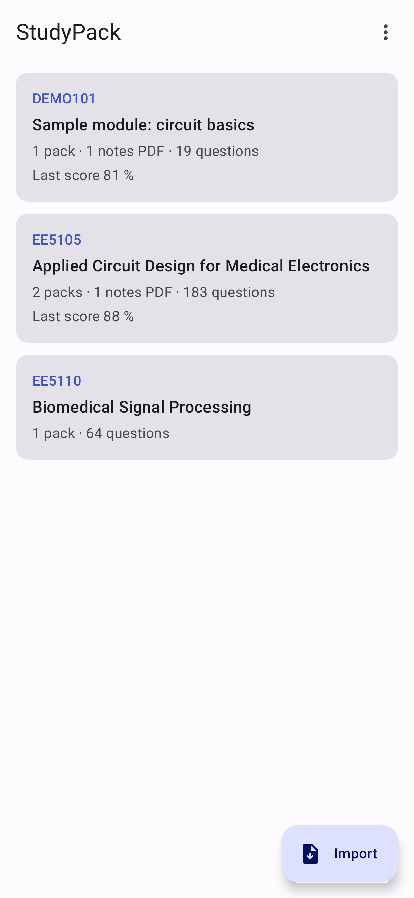
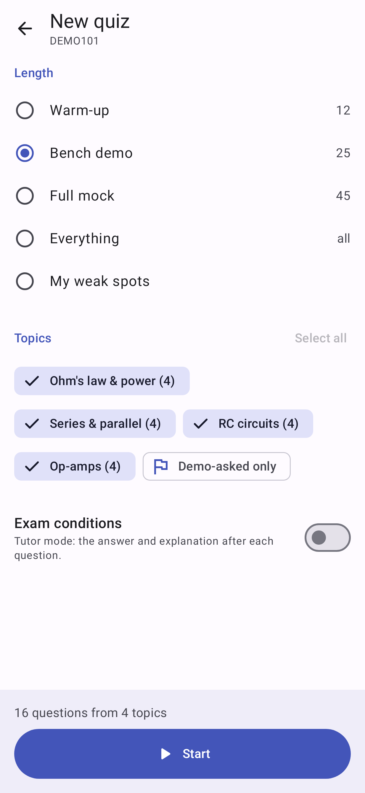
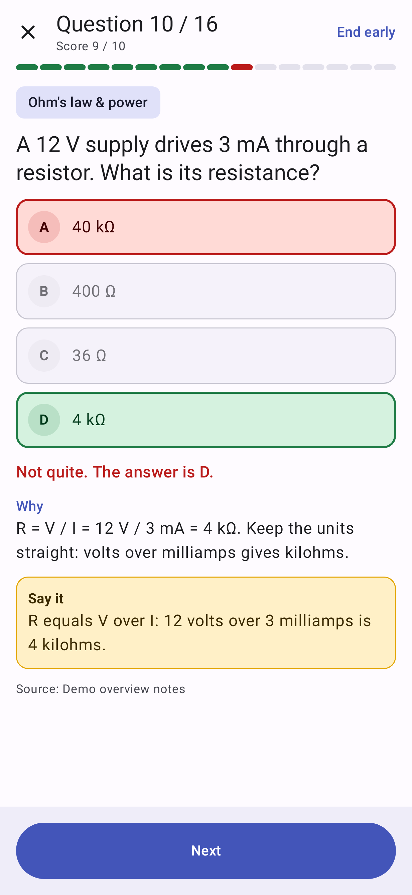
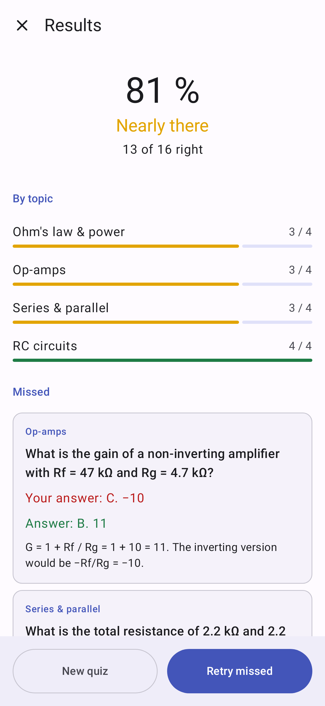
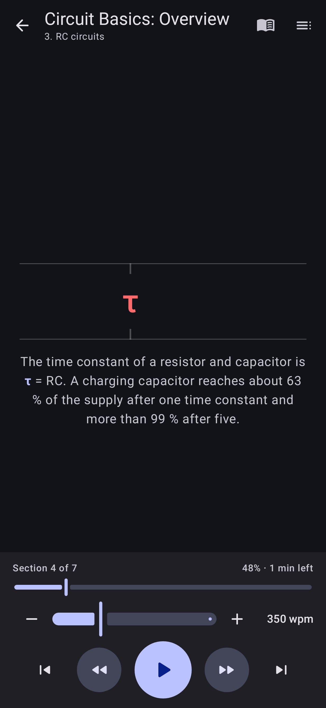

# StudyPack

A small, offline Android app for revising modules. It imports two kinds of file:

1. **Question packs** (`.studypack.json`): single-answer multiple-choice questions grouped by
   module and topic, with explanations, model answers and "say it" lines.
2. **Notes PDFs**: consolidated overview notes for a module or topic.

It runs quizzes from the packs, opens the PDFs, and can speed-read the notes word by word
(RSVP). Nothing goes to a server: no accounts, no sync, no internet permission at all.

<p>
  
  
  
  
  
</p>

The full plan this app follows is in [`docs/SCOPE.md`](docs/SCOPE.md).

## Features

- **Import** packs and PDFs from the phone, Downloads, Google Drive or OneDrive: the
  **Import** button (several files at once), "Open with StudyPack" or "Share to StudyPack".
  Files are identified by their first bytes, so a `.json` sent as `application/octet-stream`
  still imports. Packs and PDFs are copied into the app, so they keep working if the
  original is deleted.
- **Library by module.** Each module shows its notes and question packs side by side, with
  question counts and the last and best scores.
- **Quizzes** that behave like the web quiz:
  - questions shuffled, answer options shuffled;
  - picks spread across topics (a stratified round-robin), so a short exam still covers every topic;
  - lengths: Warm-up 12, Bench demo 25, Full mock 45, Everything, and **My weak spots**
    (the most-missed questions, worst first);
  - topic chips with counts, and a **Demo-asked only** chip when a pack tags questions `demo-asked`;
  - **tutor mode** (the answer, model answer, explanation and say-it box after each question)
    or **exam conditions** (change your answer until Next, feedback only at the end);
  - **calculation variants**: questions sharing a `variantGroup` fill one slot, with a
    different instance (different numbers) each session;
  - results with a verdict (≥ 85 % Demo-ready, ≥ 65 % Nearly there), a score per topic
    (worst first), a review of misses and **Retry missed**;
  - sessions survive rotation and the app being killed in the background.
- **History on the device** per question (times seen, times wrong, last seen), using the web
  quiz's weak-spot rule. Re-importing a newer version of a pack keeps history for question
  IDs that did not change.
- **Notes viewer** with page swiping, pinch zoom (double-tap to toggle), a page indicator,
  go to page, and the last page remembered. **Open in another app** hands the PDF to any
  other viewer.
- **Speed reading** (secondary tool): read a notes PDF with RSVP from the page you are on.
  Words flash at a fixed point, aligned on their optimal recognition point (the red letter),
  with sentence skip, speed control and the surrounding words shown while paused.
- **Sample pack**: an empty library offers **Load sample pack** (a short circuit-basics pack
  with its notes) so the app can be tried straight away.
- Light and dark themes following the system, Material You colours on Android 12+, fixed
  green / red / amber for right, wrong and say-it. Option cards are at least 56 dp tall, the
  Next button sits at the bottom, numbers use tabular figures, feedback is announced to
  screen readers, and every option reads as "Option B: …".

## Question pack format

A pack is one JSON file, `format: "studypack-mcq"`, `schemaVersion: 1`:

```json
{
  "format": "studypack-mcq",
  "schemaVersion": 1,
  "pack": {
    "id": "ee5105-ecg-amp",
    "title": "ECG Amplifier: Single-Supply Bench Demo",
    "moduleCode": "EE5105",
    "moduleName": "Applied Circuit Design for Medical Electronics",
    "version": "1.0.0",
    "created": "2026-11-18",
    "notes": ["EE5105-ecg-amp-overview.pdf"]
  },
  "topics": [{ "id": "cmrr", "name": "CMRR" }],
  "questions": [
    {
      "id": "cmrr-001",
      "topic": "cmrr",
      "type": "single",
      "difficulty": 2,
      "prompt": "Why does the CMRR graph peak near 5 Hz?",
      "correct": "Time-constant mismatch at low f, resistor ratio mid-band, stray C at high f",
      "distractors": ["…", "…", "…"],
      "explanation": "…",
      "modelAnswer": "…",
      "sayIt": "…",
      "variantGroup": null,
      "source": "Annotated Design Reference, derivation 5",
      "tags": ["demo-asked"]
    }
  ]
}
```

Every field and rule is in [`docs/SCOPE.md`](docs/SCOPE.md#32-question-pack-schema-schemaversion-1).
In short: question IDs must be unique and stay the same between versions (history is keyed
on them), there are exactly three distinct distractors, text is plain Unicode (no markdown,
HTML or LaTeX), and re-importing replaces a pack only if its `version` is higher (otherwise
the app asks). Errors name the field and the question ID; over-long text, single-member
variant groups and a guessable "correct answer is always the longest" pattern are warnings.

**Notes PDFs** attach to a module automatically when a pack lists the file name in
`pack.notes`, or when the file name starts with a module code
(`<MODULECODE>-<topic>-overview.pdf`). Otherwise the app asks which module they are for.

## Install the APK

1. Copy `StudyPack-1.0.0-release.apk` to your phone (Android 8.0 or newer). The APK comes
   from a [CI run's](../../actions) artifacts or from a local build (below).
2. Open it and allow installs from that source when prompted.
3. Tap **Load sample pack** to try it, or **Import** to pick your own packs and notes.

> Builds made without your own signing key are signed with a debug key. They are fine for
> sideloading, but an update signed with a different key must be installed fresh (uninstall
> first). See *Release signing* below.

## Build from source

Requirements: JDK 17+ (JDK 21 recommended) and the Android SDK with platform 37
(`ANDROID_HOME` or `local.properties`). The Gradle wrapper downloads everything else.

```bash
./gradlew assembleRelease   # → app/build/outputs/apk/release/StudyPack-1.0.0-release.apk
./gradlew assembleDebug     # → debug build (installs alongside release as "…studypack.debug")
./gradlew lint test         # static analysis + all unit, Robolectric and Compose UI tests
```

`ScreenRenderTest` renders every screen in light and dark themes and writes PNGs to
`app/build/outputs/screenshots/`.

### Release signing

Create `keystore.properties` in the project root (it is git-ignored):

```properties
storeFile=/absolute/path/to/release.jks
storePassword=…
keyAlias=…
keyPassword=…
```

In CI, set `STUDYPACK_KEYSTORE_FILE`, `STUDYPACK_KEYSTORE_PASSWORD`, `STUDYPACK_KEY_ALIAS`
and `STUDYPACK_KEY_PASSWORD` instead. Without either, release builds fall back to the debug
key.

## Project structure

```
app/          Android app: Compose UI, ViewModels, Room/DataStore data layer, import pipeline,
              PDF viewer (PdfRenderer) and notes text extraction for speed reading (PdfBox-Android)
core/quiz/    Pure Kotlin: the .studypack.json format, its validator, session building
              (stratified picks, variant groups, weak spots, option shuffling) and scoring
core/rsvp/    Pure Kotlin: tokenizer, optimal recognition point, pacing, playback engine
docs/         The scope plan and screenshots
```

| | |
|---|---|
| Language | Kotlin 2.4, coroutines and Flow, kotlinx.serialization |
| UI | Jetpack Compose, Material 3, Navigation 3 |
| Data | Room (exported schemas), DataStore, app-private file storage |
| Build | Gradle 9.8, AGP 9.4, version catalog, R8 |
| SDK | min 26 (Android 8.0), target/compile 37 |
| Tests | JUnit 4, coroutines-test, Robolectric, Compose UI test |

The quiz engine and validator are tested against the real 183-question EE5105 ECG pack,
including 1,000-seed property loops (every topic covered, one instance per variant group,
correct answer tracked through the shuffle, seeded sessions reproducible).

## Continuous integration

`.github/workflows/android.yml` runs lint, all tests and `assembleRelease` on every pull
request and push to `main`, and uploads the APK as a build artifact.

## History

This repository began as SpeedRead, an RSVP reader for EPUBs, PDFs and news. StudyPack keeps
its RSVP engine (`core/rsvp`) as a secondary tool and drops the rest (news, sports, EPUB,
widgets, notifications), so the app needs no permissions and works fully offline.
